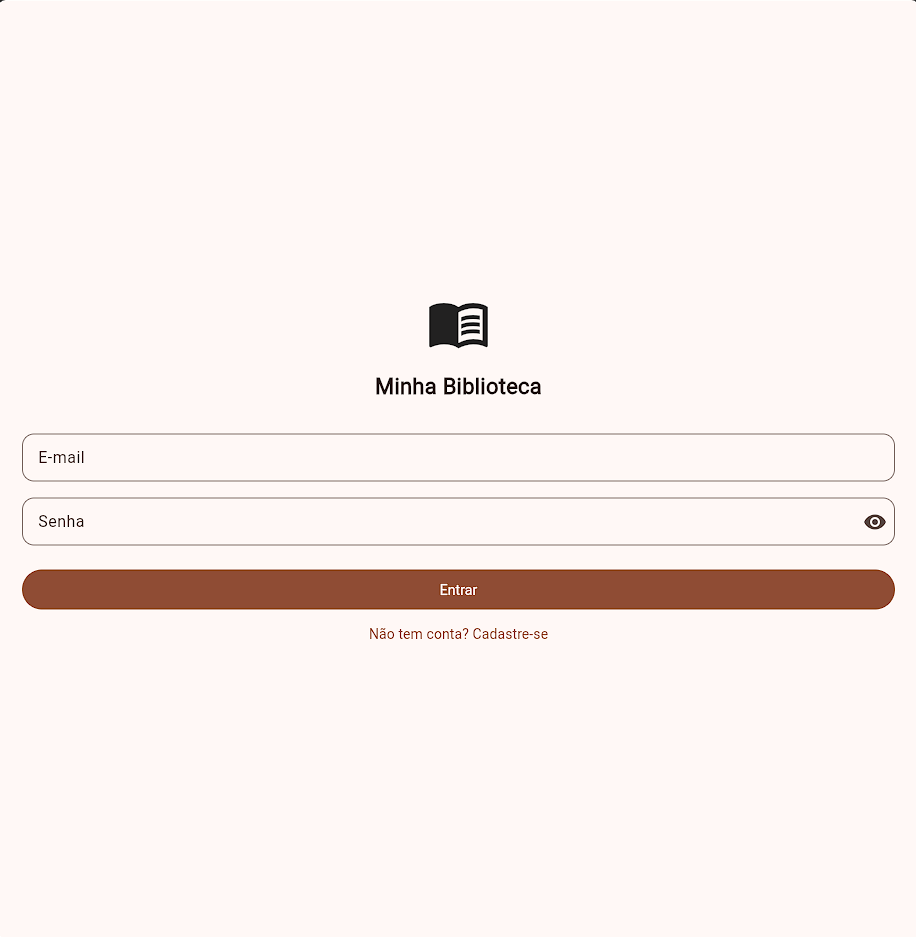
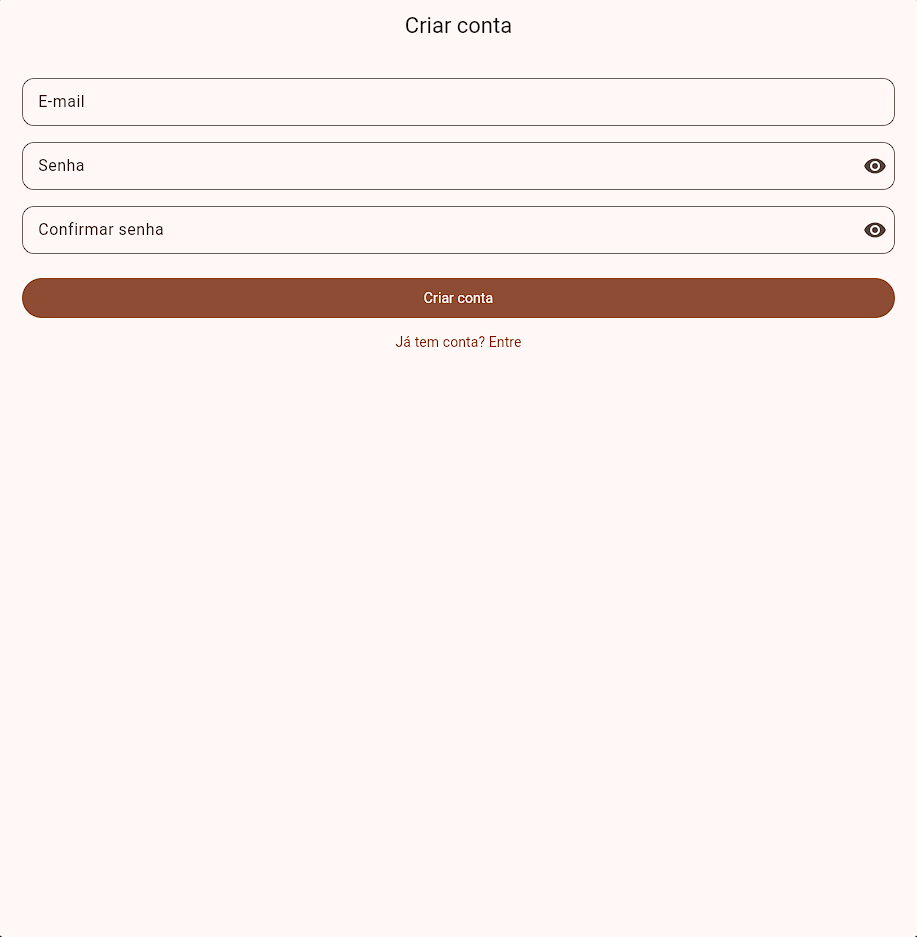
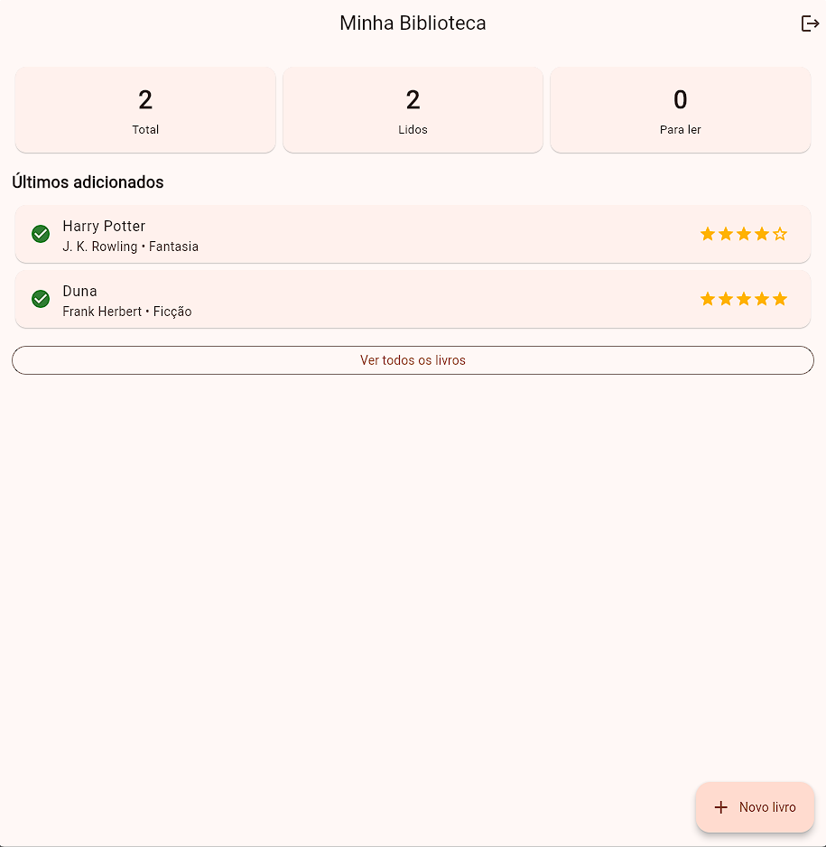
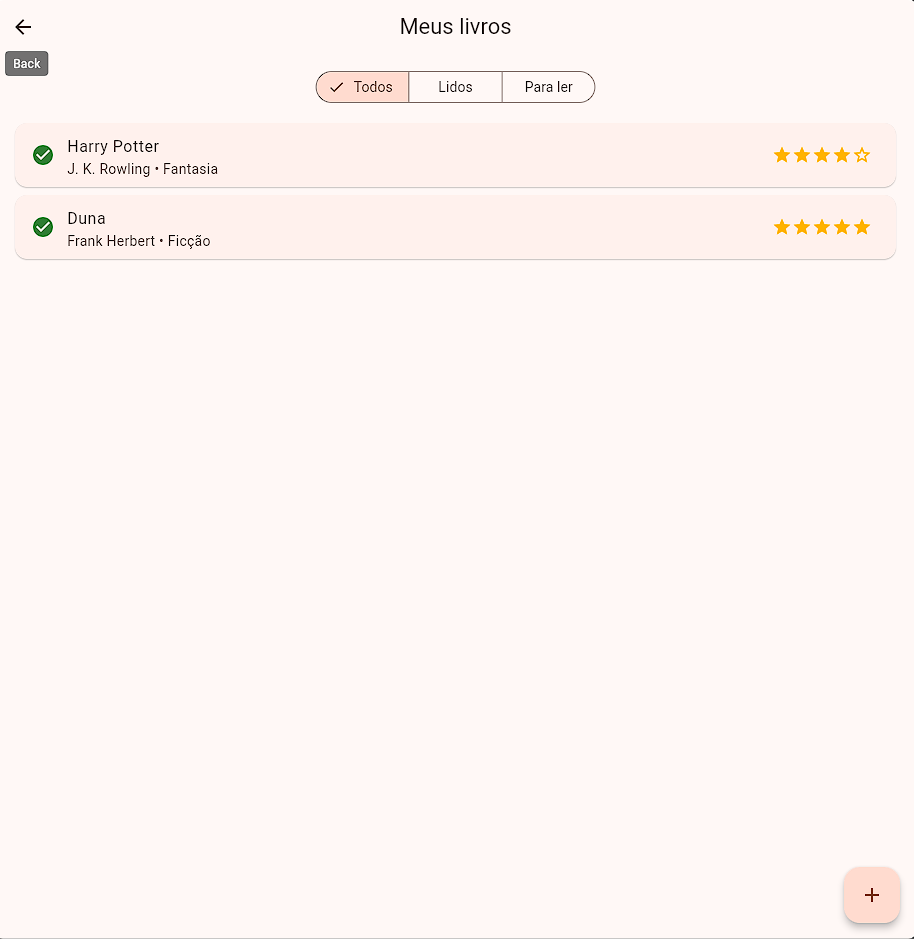
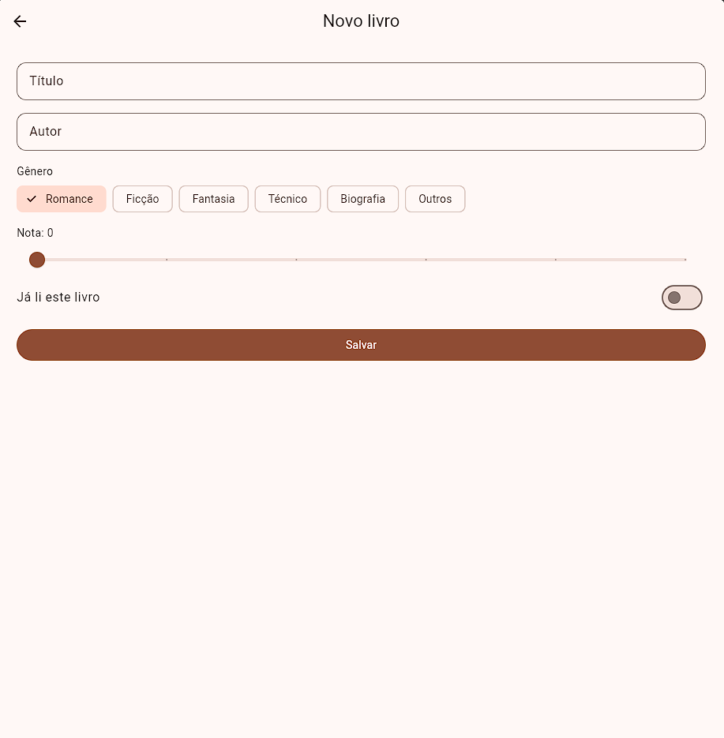

# Book Vault – Minha Biblioteca

- **Aluno:** GABRIEL HENRIQUE DA SILVA
- **Disciplina / Instituição:** Programação para Dispositivos Móveis – Uniguairacá
- **Back-end escolhido:** **Opção B – Firebase Firestore** (`cloud_firestore`), com **Firebase Authentication** (e-mail e senha)

## Descrição do app

O usuário cria uma conta, entra e cadastra os livros que leu ou quer ler. Cada livro tem título, autor, gênero, nota de 0 a 5 e se já foi lido. A home mostra um resumo (total, lidos e para ler) e os últimos livros adicionados. A lista permite filtrar por Todos, Lidos e Para ler.

## Telas e rotas

Todas as rotas são nomeadas e ficam em `lib/core/routes/app_routes.dart`. A navegação usa `context.goNamed(...)`.

| Tela | Arquivo | Nome da rota | Caminho |
|---|---|---|---|
| Login | `screens/auth/login_screen.dart` | `login` | `/login` |
| Registro | `screens/auth/registro_screen.dart` | `registro` | `/registro` |
| Home (resumo) | `screens/home/home_screen.dart` | `home` | `/` |
| Lista de livros | `screens/livros/livros_screen.dart` | `livros` | `/livros` |
| Novo livro | `screens/livros/livro_form_screen.dart` | `livro-novo` | `/livros/novo` |
| Detalhes | `screens/livros/livro_detalhe_screen.dart` | `livro-detalhe` | `/livros/:id` |
| Editar livro | `screens/livros/livro_form_screen.dart` | `livro-editar` | `/livros/:id/editar` |
    Um `redirect` no `GoRouter` envia para `/login` quem não está autenticado e leva para `/` quem já está logado.

lib/
├── main.dart          # inicialização do Firebase
├── app.dart           # widget raiz: tema + GoRouter
├── core/
│   ├── constants/     # textos fixos da interface (AppStrings)
│   ├── routes/        # nomes e caminhos das rotas
│   ├── theme/         # cores, espaçamentos, tipografia e ThemeData
│   └── utils/         # validadores e formatadores
├── models/            # Livro (fromMap / toMap)
├── services/          # AuthService e LivroService (Firebase)
├── screens/           # auth, home, livros
└── widgets/           # componentes reutilizáveis
```
## Como rodar o projeto

### Pré-requisitos

- Flutter instalado (`flutter doctor` sem erros)
- Conta no Google e um projeto no [Firebase Console](https://console.firebase.google.com)
- Node.js e Firebase CLI (`npm install -g firebase-tools`) para usar o FlutterFire

### Passo a passo

1. Clone o repositório e entre na pasta:
   ```bash
   git clone URL_DO_REPOSITORIO
   cd book_vault
   ```
2. Se as pastas nativas não existirem, gere-as (isso não altera o `lib/`):
   ```bash
   flutter create . --platforms=android,ios,web
   ```
3. No Firebase Console, crie um projeto e ative:
   - **Firestore Database**
   - **Authentication → Método de login → E-mail/senha**
4. Configure o Firebase no app. Isso gera o `lib/firebase_options.dart`, que **não é versionado** por conter dados do projeto:
   ```bash
   dart pub global activate flutterfire_cli
   flutterfire configure
   ```
5. No Firestore, em **Regras**, publique:
   ```
   rules_version = '2';
   service cloud.firestore {
     match /databases/{database}/documents {
       match /usuarios/{uid}/livros/{livroId} {
         allow read, write: if request.auth != null && request.auth.uid == uid;
       }
     }
   }
   ```
6. Instale as dependências e rode:
   ```bash
   flutter pub get
   flutter run
   ```

## Prints das telas

| Login | Registro |
|---|---|
|  |  |

| Home | Lista de livros |
|---|---|
|  |  |

| Novo / editar livro | Detalhes |
|---|---|
| 

